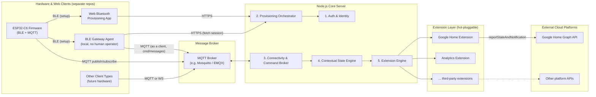

# 2. System Topology

[← 1. Overview](./01-overview.md) | [Back to index](./README.md) | Next: [3. Authentication & Identity →](./03-authentication-identity.md)

---

## 2.1 Repository & Trust Boundaries

Four categories of code exist, and each is **independently deployable, independently versioned, and independently owned**. The only thing connecting them is a documented network protocol.

```
                                   ┌───────────────────────────────────────┐
                                   │        EXTERNAL CLOUD PLATFORMS         │
                                   │  (Google Home Graph, Alexa Event GW,    │
                                   │   third-party analytics SaaS, etc.)     │
                                   └───────────────────▲─────────────────────┘
                                                        │ HTTPS / Webhooks
                                                        │ (extension-owned credentials)
┌───────────────────────────┐     ┌────────────────────┴─────────────────────┐
│   HARDWARE CLIENT REPO(S)  │     │            NODE.JS CORE SERVER            │
│   e.g. firmware-esp32c6    │     │                                            │
│   (isolated repository,    │     │  ┌──────────────┐   ┌───────────────────┐ │
│    C/C++, no Core code)    │     │  │  Core Pillars │   │  Extension Layer   │ │
│                             │◄────┼─►│  (1-4, ch3-6) │◄─►│  (Plugin Runtime,  │ │
│  ┌───────────────────────┐ │ MQTT│  │               │   │   ch. 7)           │ │
│  │ BLE Provisioning Radio │ │ /WS │  └──────────────┘   │  ┌───────────────┐ │ │
│  └───────────────────────┘ │     │                       │  │ Google Home    │ │ │
│  ┌───────────────────────┐ │     │                       │  │ Extension      │ │ │
│  │ MQTT/WS Client         │ │     │                       │  │ (ch. 8, optional)│ │
│  └───────────────────────┘ │     │                       │  └───────────────┘ │ │
└─────────────▲─────────────┘     │                       │  ┌───────────────┐ │ │
              │ BLE                │                       │  │ ...other       │ │ │
              │ (BLE_PROVISIONING_ │                       │  │ extensions     │ │ │
              │  PROTOCOL.md)      │                       │  └───────────────┘ │ │
┌─────────────┴─────────────┐     │                       └───────────────────┘ │
│  BLE GATEWAY AGENT          │     │  Provisioning API                            │
│  (separate repo, optional)  │◄───►│  (ch. 4) — commands this agent the same       │
│  local BLE radio, no human  │MQTT │  way it commands any device (ch. 5), never    │
│  operator required           │/WS  │  touches BLE itself                           │
└───────────────────────────┘     │                                              │
┌───────────────────────────┐     │                                              │
│  WEB PROVISIONING CLIENT    │     │                                              │
│  (separate repo, optional)  │◄───►│  (alternative to the Gateway Agent — a        │
│  Chrome Web Bluetooth UI    │HTTPS│  human drives the same protocol manually)     │
└───────────────────────────┘     └────────────────────────────────────────────┘
```

Both the Web Provisioning Client and the BLE Gateway Agent implement the *same* wire-level BLE contract ([`BLE_PROVISIONING_PROTOCOL.md`](./BLE_PROVISIONING_PROTOCOL.md)) — the bytes going to the firmware don't change. What differs is who drives them: a human operating an app (`ble-wifi` provisioning strategy), or an automated agent commanded by the Core itself (`ble-gateway` strategy) — see [Ch. 4, §4.3](./04-device-provisioning.md#43-reference-strategies-ble-onboarding).

### 2.1.1 Boundary Rules

| Boundary | Rule |
|---|---|
| Core ↔ Hardware Client | Communicate only via the documented MQTT/WebSocket wire protocol ([Ch. 5](./05-connectivity-broker.md)) and the provisioning API ([Ch. 4](./04-device-provisioning.md)). No shared code, no shared repo, no compile-time dependency. |
| Core ↔ Web Provisioning Client | HTTPS REST + Web Bluetooth GATT profile defined by the provisioning orchestrator. The web client is a *reference* implementation, not a required one — any client that speaks the protocol qualifies. |
| Core ↔ BLE Gateway Agent | Same MQTT/WebSocket wire protocol as any device ([Ch. 5](./05-connectivity-broker.md)) plus the same HTTPS provisioning API a human-driven client would use ([Ch. 4](./04-device-provisioning.md)) — no separate protocol or Core-side special-casing. The Core commands it, but never itself touches BLE. |
| Core ↔ Extension Layer | In-process plugin API ([Ch. 7](./07-extension-engine.md)) or out-of-process via an internal RPC/event bus for extensions that opt into process isolation. Extensions are loaded, never imported by name in Core source. |
| Extension ↔ External Cloud Platform | Fully owned by the extension. The Core has no knowledge of, or credentials for, Google Home Graph, Alexa, or any other external platform. |

## 2.2 Deployment Topology



## 2.3 Physical Deployment Notes

- **Core Server**: Stateless-per-request Node.js process(es) behind a load balancer; horizontal scaling requires the state engine and session store to be backed by shared infrastructure (Redis/Postgres — see [Ch. 6](./06-state-engine.md#63-persistence--scaling)), not in-process memory.
- **MQTT Broker**: Runs as independent infrastructure (e.g., EMQX, Mosquitto, AWS IoT Core). The Core is a client of the broker, not the broker itself, which allows the broker to be swapped or scaled independently.
- **Extensions**: Loaded in-process by default for low-latency hooks, with an escape hatch to run as a separate worker process/container for extensions with heavy or untrusted workloads (see [Ch. 7](./07-extension-engine.md#77-process-isolation-mode) and [Ch. 10](./10-concurrency-strategy.md)).
- **Hardware Clients**: Never deployed alongside the Core. Firmware is built, versioned, and released entirely independently (its own CI/CD, its own release cadence).
- **BLE Gateway Agent** (optional): Runs locally, near the devices it provisions — a physical requirement, since BLE has a range of meters, not the internet. It is *not* deployed alongside the Core (which may be cloud-hosted, with no BLE radio at all); it connects to the Core over the same network transport any device would.

## 2.4 Why This Separation Matters

1. **Independent release cadences.** Firmware ships on hardware-team timelines (regulatory, OTA rollout caution); the Core ships on software-team timelines (continuous deployment). Coupling them would force the faster team to wait on the slower one.
2. **Multi-client-type support.** The five pillars were designed under the assumption that ESP32-C6 is client type #1 of *N*. A second hardware line, a virtual/simulated device, or a third-party manufacturer's device can all onboard through the same provisioning and connectivity contracts without Core changes.
3. **Extension marketplace viability.** Because Google Home is "just an extension," the same plugin contract can host community- or vendor-authored extensions without the Core team reviewing or trusting their internals beyond the sandbox boundary.
4. **Security blast radius.** A vulnerability in a specific extension (e.g., a buggy third-party webhook handler) cannot, by construction, obtain direct access to raw MQTT credentials, the auth database, or other extensions' data (see [7.6 Data Isolation](./07-extension-engine.md#76-data-isolation)).

---

[← 1. Overview](./01-overview.md) | [Back to index](./README.md) | Next: [3. Authentication & Identity →](./03-authentication-identity.md)
