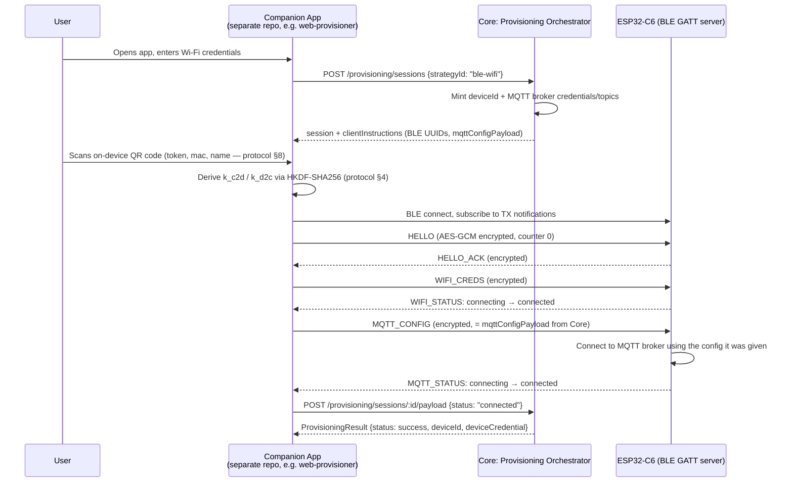

# 4. Device Setup & Provisioning Orchestrator

[← 3. Authentication & Identity](./03-authentication-identity.md) | [Back to index](./README.md) | Next: [5. Connectivity & Command Broker →](./05-connectivity-broker.md)

---

## 4.1 Responsibility Statement

The Provisioning Orchestrator turns an unconfigured physical device into a device the Core can address on the Connectivity Broker ([Ch. 5](./05-connectivity-broker.md)). It defines a **strategy interface** for "how does a device get its network credentials and identity" and ships with a first strategy (Web Bluetooth / BLE) implemented against that interface — it does not assume BLE is the only or permanent onboarding mechanism.

## 4.2 Provisioning Strategy Abstraction

```ts
interface ProvisioningStrategy {
  id: string;                                  // "ble-wifi", "ble-gateway", "soft-ap", ...
  beginSession(actorUserId: string): Promise<ProvisioningSession>;
  submitPayload(sessionId: string, payload: unknown): Promise<ProvisioningResult>;
  cancel(sessionId: string): Promise<void>;

  // Optional: for strategies that drive provisioning themselves rather than
  // waiting on an external submitPayload call (e.g. ble-gateway, §4.3.4).
  // Fires once the session is durably stored; the strategy resolves it later
  // via ctx.resolveSession(result) from wherever its own async work
  // completes (typically a State Engine subscription, ch.6 §6.5).
  onSessionStarted?(session: ProvisioningSession, ctx: ProvisioningStrategyContext): void;
}

interface ProvisioningStrategyContext {
  state: StateQuery;                                    // ch.6 §6.5
  commands: { dispatch(cmd: CoreCommand): Promise<void> }; // ch.5 §5.4
  resolveSession(result: ProvisioningResult): void;
}

interface ProvisioningSession {
  sessionId: string;
  strategyId: string;
  expiresAt: string;
  clientInstructions: Record<string, unknown>;  // strategy-defined, opaque to Core
}

interface ProvisioningResult {
  status: "pending" | "success" | "failed";
  deviceId?: string;         // Core-assigned canonical ID, only on success
  deviceCredential?: string; // opaque credential handed to the device for the broker (§4.3)
  error?: { code: string; message: string };
}
```

The orchestrator's HTTP layer is strategy-agnostic:

| Method | Path | Purpose |
|---|---|---|
| `POST` | `/provisioning/sessions` | `{ strategyId }` → creates a `ProvisioningSession` |
| `POST` | `/provisioning/sessions/:id/payload` | Strategy-specific payload (e.g., BLE-relayed Wi-Fi credentials + device pubkey) |
| `GET`  | `/provisioning/sessions/:id` | Poll session status |
| `DELETE` | `/provisioning/sessions/:id` | Cancel/expire |

Because `clientInstructions` and the payload body are opaque `unknown`/`Record` types at the Core boundary, adding a second strategy (e.g., a "soft-AP + captive portal" flow, or a "scan a QR code to claim a cloud-preregistered device") requires writing a new class that implements `ProvisioningStrategy` and registering it — no changes to the HTTP routes, database schema, or any existing strategy.

## 4.3 Reference Strategies: BLE Onboarding

Two strategies implement onboarding for the ESP32-C6 client family, both against the interface in §4.2 — the orchestrator core has no BLE-specific code either way. They differ only in *who* drives the BLE handshake: a human operating a companion app (§4.3.1–4.3.3, strategy id `ble-wifi`, reference implementation: `web-provisioner/`), or an automated agent commanded by the Core itself (§4.3.4, strategy id `ble-gateway`, reference implementation: `ble-gateway-agent/`). The wire-level bytes going to the firmware are identical in both cases — specified in **[`PROVISIONING_PROTOCOL_V2.md`](./PROVISIONING_PROTOCOL_V2.md)**, a separate, narrower contract the firmware repository and whatever drives the BLE side (app or gateway agent) both implement against directly. This chapter describes what the Core does in each case; that document is the source of truth for what goes over the air.

### 4.3.1 Flow (`ble-wifi`, App-Driven)

The companion app (a Web Bluetooth page in Chrome, or a native mobile app — the protocol doc is transport-client-agnostic) is the only thing that ever speaks BLE. Note the ordering: the Core is called **before** the BLE handshake starts (to mint the identity and broker credentials the app needs to hand the device) and **after** it finishes (to confirm the outcome) — never during.



### 4.3.2 Why the Companion App Talks to the Device Directly

The Core never communicates over BLE — it has no BLE stack and runs server-side, decoupled from client-local radios. The **client-side app** bridges BLE ↔ HTTPS: it fetches the device identity and MQTT broker connection details from the Core over HTTPS *before* touching BLE, then relays that config to the device over BLE, and reports the outcome back to the Core over HTTPS once the device confirms it's connected. The Core only ever sees HTTPS payloads; the fact that BLE was involved at all — and everything about how it was involved, including the AES-GCM session encryption — is entirely defined by [`PROVISIONING_PROTOCOL_V2.md`](./PROVISIONING_PROTOCOL_V2.md), not by this chapter, matching the [P5 principle](./01-overview.md#14-non-goals) of repository/trust separation.

### 4.3.3 Credential Issuance

Credential issuance happens **before** the BLE handshake, not after: `beginSession` mints both the `deviceId` and the MQTT broker credentials (username/password or, in higher-security deployments, material for a per-device X.509 client certificate) the device will use against the Connectivity Broker ([Ch. 5](./05-connectivity-broker.md)), and returns them as part of `clientInstructions` for the app to relay over BLE. The Core records this as a `device_credentials` row ([Ch. 3, §3.3](./03-authentication-identity.md#33-data-model-core-owned)) at mint time, not at confirmation time — a device that never completes the BLE handshake simply leaves an unused, revocable credential behind rather than a validated one. This credential is: scoped to exactly one `deviceId`, revocable independently of any user session, and never reused across strategies — a device provisioned via BLE and a hypothetical future device provisioned via QR-claim receive credentials from the same minting code path.

### 4.3.4 Flow (`ble-gateway`, Server-Driven)

For deployments where a human running an app for every device isn't practical, the **BLE Gateway Agent** ([Ch. 2, §2.2](./02-system-topology.md#22-deployment-topology)) fills the same role a companion app fills in §4.3.1, but is commanded remotely by the Core instead of operated by a person. The Core still never touches BLE itself — it commands the gateway agent exactly the way it commands any device, over the same Connectivity Broker ([Ch. 5](./05-connectivity-broker.md)).

```mermaid
sequenceDiagram
    participant Operator
    participant Core as Core: Provisioning Orchestrator
    participant Gateway as BLE Gateway Agent<br/>(separate repo, local BLE radio)
    participant Device as ESP32-C6 (BLE GATT server)

    Operator->>Core: POST /provisioning/sessions {strategyId: "ble-gateway"}
    Core->>Core: Mint deviceId + MQTT broker credentials/topics
    Core-->>Operator: session {sessionId, clientInstructions}
    Core->>Gateway: CoreCommand {action: "provision", value: sessionId}<br/>(dispatched automatically, same path as any command)
    Gateway->>Core: GET /provisioning/sessions/:sessionId (fetch full clientInstructions)
    Core-->>Gateway: clientInstructions (BLE UUIDs, mqttConfigPayload)
    Gateway->>Operator: Logs "waiting for QR for session X" + a ready-to-run curl command
    Operator->>Device: Scans the device's on-screen QR (any reader — no app needed for this step)
    Operator->>Gateway: POST http://localhost:4001/qr {sessionId, qrJson}
    Gateway->>Gateway: Derive k_c2d / k_d2c via HKDF-SHA256 (protocol §4)
    Gateway->>Device: BLE scan for the QR's device name, connect, subscribe to TX
    Gateway->>Device: HELLO / HELLO_ACK, then WIFI_CREDS, poll WIFI_STATUS until connected
    Gateway->>Device: MQTT_CONFIG (= mqttConfigPayload), poll MQTT_STATUS until connected
    Device->>Device: Connect to MQTT broker using the config it was given
    Gateway->>Core: CoreEvent {componentId: "ble-gateway", eventType: "provisioning_result",<br/>value: sessionId, metadata: {outcome: "success", deviceId}}<br/>(published like any device's telemetry — ch.5 §5.3)
    Core->>Core: State Engine emits state.changed; ble-gateway strategy's<br/>subscription matches sessionId, resolves the session
```

Two shape constraints from §4.2/ch.5 fall out of reusing the existing broker/state primitives rather than inventing a parallel channel:

- **The command carries only the sessionId**, not the full `mqttConfigPayload` — `CoreCommand.value` is scalar-only ([Ch. 5, §5.4](./05-connectivity-broker.md#54-routing-inbound-telemetry-and-outbound-commands)). The gateway agent fetches the rest over the same HTTPS provisioning API a human-driven app would use.
- **The report's `value` is the sessionId itself**, not the outcome — the State Engine's change detection diffs only on `value` ([Ch. 6, §6.4](./06-state-engine.md#64-update--subscription-model)); putting the outcome there would make two different sessions that both happen to report "success" back-to-back collide as an unchanged value and get silently downgraded to a `state.heartbeat`. The actual outcome (`success`/`failed`, `deviceId`, failure `reason`) travels in `metadata` — the documented opaque pass-through bag ([Ch. 6, §6.1](./06-state-engine.md#61-the-canonical-abstraction-packet)) — which the `ble-gateway` strategy reads but the State Engine itself never interprets.

If no gateway agent is connected (or it never reports back), the session simply stays `pending` until a strategy-defined timeout, then resolves to `failed` — the same graceful-degradation shape as any other unresolved provisioning attempt (§4.5), not a special case.

**Security note:** Provisioning Protocol v2's entire security model is physical possession of the device's on-screen QR code ([`PROVISIONING_PROTOCOL_V2.md`](./PROVISIONING_PROTOCOL_V2.md) §1, §11) — whoever can see that screen is authorized. A gateway agent has no camera, so it cannot obtain the QR itself; the diagram above deliberately keeps an operator in the loop for exactly that one step, scanning the QR with any reader and relaying the decoded JSON to the agent's local input endpoint. "Server-driven" here means the *BLE handshake* is automated, not that a human is removed from the loop entirely — a gateway agent that somehow fully automated QR acquisition (e.g. an attached camera pointed at the device) would need to preserve the same proof-of-possession property, not bypass it.

## 4.4 Hooks for Alternative Onboarding Strategies

The interface in §4.2 anticipates non-BLE onboarding without modification:

| Strategy (hypothetical) | `beginSession` behavior | `submitPayload` behavior |
|---|---|---|
| `soft-ap` | Instructs client app to connect to device's temporary AP and hit its local HTTP config server | Device-local server relays result back to Core once it has Wi-Fi |
| `qr-cloud-claim` | Device is pre-registered with a claim code at manufacture time | User scans QR → app submits claim code → Core matches pre-registered device record |
| `zero-touch-enterprise` | Bulk-import of device identities via signed manifest | Devices self-attest against manifest on first boot |

Each is a self-contained module registered with the orchestrator's strategy registry (structurally identical to extension registration, [Ch. 7, §7.3](./07-extension-engine.md#73-registration--manifest)) — provisioning strategies are, in effect, a specialized case of the same "pluggable module" philosophy that governs extensions, though they are bundled with the Core (not third-party-installable) because provisioning is a foundational pillar, not an optional feature.

## 4.5 Provisioning Session State Machine

```
  ┌─────────┐  beginSession   ┌─────────┐  submitPayload(valid)   ┌─────────┐
  │ (none)  │ ───────────────►│ pending │ ───────────────────────►│ success │
  └─────────┘                 └────┬────┘                         └─────────┘
                                    │ submitPayload(invalid) / timeout / cancel
                                    ▼
                               ┌─────────┐
                               │ failed  │
                               └─────────┘
```

Sessions expire after a strategy-defined TTL (default 5 minutes) to bound the window during which a partially-provisioned device credential negotiation can be interfered with. Self-driving strategies (§4.3.4) additionally apply their own, typically shorter, timeout while waiting for their agent's report — resolving to `failed` rather than leaving the session `pending` indefinitely if the agent never responds.

---

[← 3. Authentication & Identity](./03-authentication-identity.md) | [Back to index](./README.md) | Next: [5. Connectivity & Command Broker →](./05-connectivity-broker.md)
