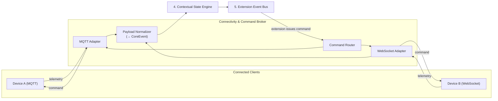

# 5. Unified Connectivity & Command Broker

[← 4. Device Provisioning](./04-device-provisioning.md) | [Back to index](./README.md) | Next: [6. Contextual State Engine →](./06-state-engine.md)

---

## 5.1 Responsibility Statement

The Connectivity Broker is the single point through which every byte enters or leaves the Core to/from any connected client. It normalizes heterogeneous transports (MQTT, WebSocket, and future adapters) into one internal event shape, so nothing downstream (State Engine, Extension Engine) needs to know or care which transport a given client used.

## 5.2 Transport Adapter Abstraction

```ts
interface TransportAdapter {
  id: string;                        // "mqtt", "websocket", ...
  start(): Promise<void>;
  stop(): Promise<void>;
  onInbound(handler: (msg: InboundMessage) => void): void;
  sendOutbound(msg: OutboundMessage): Promise<void>;
}

interface InboundMessage {
  clientId: string;         // canonical deviceId (from provisioning, ch. 4) or session-bound client id
  transport: string;        // adapter id, for diagnostics only
  topic: string;            // transport-native routing key (MQTT topic / WS channel)
  payload: Buffer;          // raw bytes; adapter-specific codec parses this
  receivedAt: string;
}

interface OutboundMessage {
  clientId: string;
  topic: string;
  payload: Buffer;
  qos?: 0 | 1 | 2;           // honored by adapters that support QoS (MQTT); ignored otherwise
}
```

Two adapters ship with the Core:

- **MQTT Adapter** — connects to an external MQTT broker (Mosquitto/EMQX/AWS IoT Core) as a privileged client, subscribes to a device-namespaced wildcard (`devices/+/messages`), and publishes commands to `devices/{deviceId}/cmd`. This is the same topic scheme the BLE provisioning strategy hands each device via `mqtt-config` ([`BLE_PROVISIONING_PROTOCOL.md`](./BLE_PROVISIONING_PROTOCOL.md) §5) — a device configured with one topic scheme and a broker adapter listening on another is a silent dead end, so the two are defined together, not independently. The protocol's `cmd/result`, `config`, and `status` topics are part of the same per-device namespace for command acknowledgement, runtime config, and liveness reporting respectively; an adapter may subscribe to them as those needs arise without changing this section's shape. Per-device ACLs are enforced at the broker level using the credential minted during provisioning ([Ch. 4, §4.3.3](./04-device-provisioning.md#433-credential-issuance)).
- **WebSocket Adapter** — terminates WS connections directly in the Node.js process (for clients where a persistent broker connection isn't practical, e.g. browser-based virtual devices or low-power clients preferring a single TCP stream), authenticating the handshake against the Identity Layer ([Ch. 3](./03-authentication-identity.md)).

Adding a third transport (CoAP/UDP for constrained networks, a LoRaWAN network-server webhook bridge, raw TCP) means implementing `TransportAdapter` and registering it — the broker's routing, auth, and normalization logic is untouched.

## 5.3 Normalization: Wire Payload → Internal Event

Regardless of transport, every inbound payload is decoded into a single canonical shape before it reaches anything else in the system:

```ts
interface CoreEvent {
  clientId: string;
  componentId: string;         // opaque identifier, e.g. "knob-1", "relay-3" — no semantic meaning to Core
  eventType: string;           // "telemetry" | "focus_change" | "adjustment" | ... (namespaced, extensible)
  value: number | string | boolean | null;
  metadata?: Record<string, unknown>;  // pass-through bag, never interpreted by Core logic
  timestamp: string;
}
```

This is the same shape produced whether the source was an MQTT telemetry publish or a WebSocket frame — see [Ch. 6, §6.1](./06-state-engine.md#61-the-canonical-abstraction-packet) for how the State Engine consumes it.

## 5.4 Routing: Inbound (Telemetry) and Outbound (Commands)



- **Inbound path:** adapter receives bytes → decodes transport envelope → normalizer maps to `CoreEvent` → published onto the internal event bus, consumed first by the State Engine ([Ch. 6](./06-state-engine.md)), which then re-emits for extension consumption ([Ch. 7](./07-extension-engine.md)).
- **Outbound path:** any authorized producer (an extension, an internal automation, an admin API call) issues a `CoreCommand` addressed to a `clientId`; the Command Router resolves which adapter currently owns that client's connection and calls `sendOutbound`. The producer never talks to MQTT or WebSocket primitives directly.

```ts
interface CoreCommand {
  clientId: string;
  componentId: string;
  action: string;            // opaque, component-defined verb, e.g. "set", "toggle", "pulse"
  value?: number | string | boolean;
  correlationId?: string;    // for request/response-style command acknowledgement
}
```

## 5.5 Connection Lifecycle & Presence

The broker maintains a lightweight, in-memory (Redis-backed in multi-instance deployments) presence table: `clientId → { adapterId, connectedAt, lastSeenAt }`. Presence changes emit `connectivity.online` / `connectivity.offline` events onto the same bus telemetry uses, allowing the State Engine and extensions to react to connectivity changes (e.g., a Google Home extension marking a device unreachable, [Ch. 8, §8.4](./08-google-home-extension.md#84-query-intent-mapping)) without polling.

## 5.6 Backpressure & Delivery Guarantees

- MQTT QoS 1 is the default for command delivery (at-least-once with device-side idempotency expected on `correlationId`); telemetry ingestion tolerates QoS 0 (at-most-once) by design, since state is a "last value wins" model ([Ch. 6](./06-state-engine.md)), not an event-sourced log.
- The broker applies **per-client rate limiting** at the adapter layer to prevent a single misbehaving device from starving the event loop — see [Ch. 10, §10.4](./10-concurrency-strategy.md#104-backpressure--rate-limiting) for the concurrency-level detail.
- Outbound command delivery to an offline client is queued transport-side (MQTT retained/queued semantics) up to a bounded TTL; the broker does not implement its own redelivery/retry engine beyond what the underlying transport already guarantees, avoiding duplicated reliability logic.

---

[← 4. Device Provisioning](./04-device-provisioning.md) | [Back to index](./README.md) | Next: [6. Contextual State Engine →](./06-state-engine.md)
