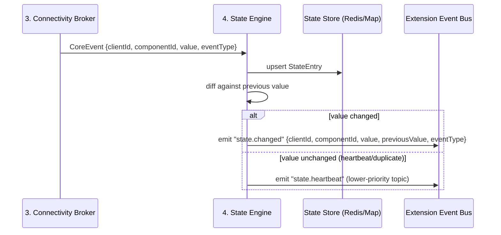

# 6. Hardware-Agnostic Contextual State Engine

[← 5. Connectivity & Command Broker](./05-connectivity-broker.md) | [Back to index](./README.md) | Next: [7. Dynamic Extension Engine →](./07-extension-engine.md)

---

## 6.1 The Canonical Abstraction Packet

Every piece of state the Core tracks is stored and transmitted as an **abstraction packet** — the same `CoreEvent` shape introduced in [Ch. 5, §5.3](./05-connectivity-broker.md#53-normalization-wire-payload--internal-event), persisted rather than transient:

```ts
interface StateEntry {
  clientId: string;
  componentId: string;
  value: number | string | boolean | null;
  updatedAt: string;
  eventType: string;          // last event type that produced this value
  metadata?: Record<string, unknown>;
}
```

The Core's contract with every client is: **you send us numbers, strings, or identifiers — we do not know or care what they mean.** A rotary encoder client might send `{ componentId: "knob-1", eventType: "adjustment", value: 42 }`; a button client might send `{ componentId: "btn-2", eventType: "focus_change", value: "component-b" }`. Both are stored identically. Rendering "42 means 42% brightness" or "component-b means the kitchen light" is entirely a client or extension concern — never Core logic.

## 6.2 The State Matrix

Conceptually, state is a sparse matrix keyed by `(clientId, componentId)`:

```
                component: knob-1   btn-2        relay-3
clientId: dev-A     { value: 42 }   { value:      { value: true,
                     eventType:      "component-b" eventType:
                     "adjustment" }  eventType:     "telemetry" }
                                     "focus_change" }
clientId: dev-B     { value: 7 }    —              —
```

- **Last-value-wins.** The engine is not an event store/event-sourcing log — it holds current state, not history. Systems that need history (analytics, audit trails) subscribe to the raw event stream via an extension and own their own time-series storage ([Ch. 7, §7.6](./07-extension-engine.md#76-data-isolation)).
- **Sparse by construction.** A `(clientId, componentId)` pair only exists once at least one event has been received for it; there is no pre-declared schema of "what components a client has." This is what makes the engine hardware-agnostic — it never needs a device-type registry to function.

## 6.3 Persistence & Scaling

| Deployment size | Backing store |
|---|---|
| Single-instance / dev | In-process `Map`, optionally snapshotted to disk |
| Production, multi-instance | Redis (hash per `clientId`, field per `componentId`) for low-latency reads shared across Core replicas, with periodic durable snapshot to Postgres for crash recovery and cold start |

Reads are always cache-first; writes go through the engine's single write path (never bypassed by adapters or extensions writing "directly" to Redis) so that the `state.changed` event (§6.4) is guaranteed to fire for every mutation, keeping subscribers consistent with stored state.

## 6.4 Update & Subscription Model



Two distinct topics are emitted deliberately:
- `state.changed` — the value differs from what was previously stored. This is what most extensions (including the Google Home extension, [Ch. 8, §8.4](./08-google-home-extension.md#84-realtime-state-reporting)) subscribe to, since Home Graph reporting should reflect *changes*, not every duplicate telemetry tick.
- `state.heartbeat` — value is identical to the last known value, but a fresh event arrived (useful for liveness/connectivity-adjacent extensions without forcing every consumer to diff manually).

## 6.5 Query API

Extensions and internal services read state through a narrow, read-only query surface rather than direct store access:

```ts
interface StateQuery {
  get(clientId: string, componentId: string): Promise<StateEntry | null>;
  getAllForClient(clientId: string): Promise<StateEntry[]>;
  subscribe(filter: { clientId?: string; componentId?: string; eventType?: string },
            handler: (change: StateChangeEvent) => void): Unsubscribe;
}
```

This indirection means the underlying store (in-memory `Map` today, Redis tomorrow, something else later) can change without any extension code changing — extensions depend on `StateQuery`, never on Redis/Map APIs directly.

## 6.6 Explicit Non-Responsibilities

To keep the engine genuinely hardware-agnostic, it explicitly does **not**:
- Validate that a `value` is "sensible" for a given `componentId` (e.g., range-checking a percentage 0–100) — that's a client- or extension-level concern, since the Core doesn't know what the component *is*.
- Maintain a device/component type registry or capability catalog. (An extension, such as the Google Home extension's device `SYNC` handler, [Ch. 8, §8.2](./08-google-home-extension.md#82-fulfillment-intent-mapping), is free to maintain its *own* mapping of `componentId → Google device trait`, entirely outside the Core.)
- Render or format values for display.

---

[← 5. Connectivity & Command Broker](./05-connectivity-broker.md) | [Back to index](./README.md) | Next: [7. Dynamic Extension Engine →](./07-extension-engine.md)
