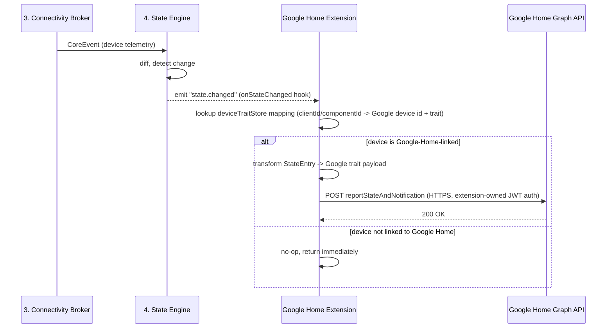

# 8. Google Home Integration Extension — Deep Dive

[← 7. Dynamic Extension Engine](./07-extension-engine.md) | [Back to index](./README.md) | Next: [9. Event-Driven Data Flow →](./09-event-driven-data-flow.md)

---

## 8.1 Purpose of This Chapter

This chapter is a **worked example** — it exists to prove, concretely, that the plugin framework from [Ch. 7](./07-extension-engine.md) is sufficient to host a real, production-grade third-party integration without a single line of Google-specific code entering the Core. Everything described here lives in `extensions/google-home/` (its own package/repo), installed and enabled like any other extension.

If the Google Home extension were disabled or uninstalled tomorrow, the five Core pillars would continue operating identically for every other client and extension — this is the architectural property being demonstrated.

## 8.2 Fulfillment Intent Mapping

Google's Smart Home platform sends three primary intents to a fulfillment webhook. The extension owns translating each into the Core's hardware-agnostic vocabulary.

| Google Intent | Extension Behavior |
|---|---|
| `action.devices.SYNC` | Reads the extension's **own** device-trait mapping table (isolated storage, [Ch. 7, §7.6](./07-extension-engine.md#76-data-isolation)) — populated when a user opts a device into Google Home exposure — and returns Google-formatted device descriptors (`type`, `traits`, `name`). The Core has no concept of "traits"; this mapping exists only inside the extension. |
| `action.devices.QUERY` | Calls `ctx.state.getAllForClient(deviceId)` (Core's read-only [`StateQuery`](./06-state-engine.md#65-query-api)) for each requested device, then transforms the raw `StateEntry[]` into Google's expected trait-state JSON shape. |
| `action.devices.EXECUTE` | Translates a Google command (e.g., `action.devices.commands.OnOff { on: true }`) into a Core `CoreCommand` and calls `ctx.commands.dispatch(cmd)` ([Ch. 5, §5.4](./05-connectivity-broker.md#54-routing-inbound-telemetry-and-outbound-commands)). The Core routes it to the correct transport adapter without knowing "Google" was involved. |

```ts
// extensions/google-home/fulfillment.ts (illustrative excerpt)
export async function handleExecute(intent: GoogleExecuteIntent, ctx: CoreExtensionContext) {
  const results = [];
  for (const cmd of intent.payload.commands) {
    for (const device of cmd.devices) {
      const mapping = await deviceTraitStore.get(device.id);       // extension-owned mapping
      const coreCommand: CoreCommand = {
        clientId: mapping.coreClientId,
        componentId: mapping.coreComponentId,
        action: translateGoogleExecutionToAction(cmd.execution[0]), // e.g. OnOff -> "set"
        value: cmd.execution[0].params.on,
      };
      await ctx.commands.dispatch(coreCommand);
      results.push({ ids: [device.id], status: "SUCCESS" });
    }
  }
  return { requestId: intent.requestId, payload: { commands: results } };
}
```

## 8.3 Account Linking (OAuth Handshake)

Google Home requires account linking so a user's Google account maps to their Core account. The extension implements the `AccountLinkingProvider` port defined in [Ch. 3, §3.2.4](./03-authentication-identity.md#324-third-party-account-linking-interface):

```ts
// extensions/google-home/account-linking.ts
export class GoogleHomeLinkingProvider implements AccountLinkingProvider {
  id = "google-home";

  async initiateLink(userId: string) {
    const state = signState({ userId });
    return { redirectUrl: `https://accounts.google.com/o/oauth2/v2/auth?...&state=${state}` };
  }

  async handleCallback(userId: string, query: Record<string, string>) {
    const tokens = await exchangeCodeForTokens(query.code);   // extension-owned HTTPS call
    return { providerId: "google-home", externalId: tokens.sub, encryptedTokens: encrypt(tokens) };
  }

  async revoke(userId: string, linkedAccountId: string) {
    await revokeGoogleToken(linkedAccountId);
  }
}

// registered at enable-time:
async onEnable(ctx: CoreExtensionContext) {
  ctx.identity.registerAccountLinkingProvider(new GoogleHomeLinkingProvider());
  ctx.http.mount("/extensions/google-home", buildFulfillmentRouter(ctx));
}
```

The Core's `linked_accounts` table stores the *fact* of the link (§[3.3](./03-authentication-identity.md#33-data-model-core-owned)); the *content* of Google's tokens is opaque `jsonb` the Core never parses. This is what "third-party platform account linking interfaces" (Pillar 1) means in practice — the interface is Core-owned, the implementation is extension-owned.

## 8.4 Realtime State Reporting → Home Graph

This is the piece that satisfies "Home Graph Integration... via free, creditless web-hooks":



```ts
// extensions/google-home/index.ts
async onStateChanged(event: StateChangeEvent, ctx: CoreExtensionContext) {
  const mapping = await deviceTraitStore.findByCore(event.clientId, event.componentId);
  if (!mapping) return;                              // not exposed to Google Home — ignore

  const payload = buildReportStatePayload(mapping, event.value);
  // Fire-and-forget relative to the hot path — see ch. 10 for why this never blocks connectivity.
  void reportStateAndNotification(payload).catch(err =>
    ctx.logger.warn(`Home Graph report failed: ${err.message}`)
  );
}
```

`reportStateAndNotification` uses Google's real-time reporting endpoint authenticated via a service-account JWT — no per-call billing, hence "free, creditless" — entirely inside the extension's own HTTPS client, with its own retry/backoff policy, fully decoupled from the Core's MQTT/WebSocket hot path (elaborated in [Ch. 9](./09-event-driven-data-flow.md) and [Ch. 10](./10-concurrency-strategy.md)).

## 8.5 What the Extension Does *Not* Get Access To

Consistent with [Ch. 7, §7.6](./07-extension-engine.md#76-data-isolation):

- No direct MQTT/broker credentials — it can only issue commands through `ctx.commands.dispatch`.
- No access to other extensions' isolated storage namespaces.
- No access to raw `users`/`sessions` tables — only its own `linked_accounts` rows, surfaced through the identity port.
- No ability to modify Core state directly — it can only observe (`state.changed`) and command (`commands.dispatch`), the same two verbs available to every extension.

## 8.6 Manifest

```json
{
  "id": "google-home",
  "version": "1.4.0",
  "displayName": "Google Home Integration",
  "permissions": {
    "stateRead": true,
    "commandDispatch": true,
    "httpRoutes": true,
    "accountLinking": ["google-home"],
    "isolatedStorage": true
  },
  "entryPoint": "extensions/google-home/index.js"
}
```

This manifest is the entirety of what the Core needs to know about Google Home. Everything else — SYNC/QUERY/EXECUTE semantics, OAuth scopes, Home Graph endpoints, device trait taxonomies — is Google Smart Home platform knowledge that lives exclusively inside this one package.

---

[← 7. Dynamic Extension Engine](./07-extension-engine.md) | [Back to index](./README.md) | Next: [9. Event-Driven Data Flow →](./09-event-driven-data-flow.md)
