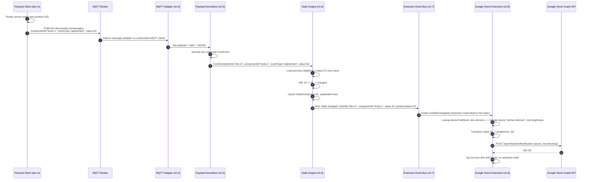

# 9. Event-Driven Data Flow — Worked Trace

[← 8. Google Home Integration Extension](./08-google-home-extension.md) | [Back to index](./README.md) | Next: [10. Concurrency & Zero-Lag Strategy →](./10-concurrency-strategy.md)

---

## 9.1 Scenario

A user physically turns a rotary knob (`componentId: "knob-1"`) on a generic client device (`clientId: "dev-A"`), changing its position to `42`. This section traces that single physical action through every pillar to its eventual appearance in Google Home, annotating which chapter governs each step.

## 9.2 Full Trace



## 9.3 Step-by-Step Chapter Cross-Reference

| Step | What happens | Governing chapter |
|---|---|---|
| 1–2 | Firmware reads a sensor and publishes an MQTT message using only generic vocabulary (`componentId`, `eventType`, `value`) — it has no knowledge that Google Home exists | [Ch. 2, §2.1](./02-system-topology.md#21-repository--trust-boundaries) (repo isolation), [Ch. 5, §5.2](./05-connectivity-broker.md#52-transport-adapter-abstraction) (MQTT adapter as the receiving end) |
| 3–4 | The MQTT Adapter receives the message; the Normalizer converts the transport-specific envelope into a canonical `CoreEvent`, indistinguishable at this point from a message that arrived over WebSocket | [Ch. 5, §5.3](./05-connectivity-broker.md#53-normalization-wire-payload--internal-event) |
| 5 | The `CoreEvent` reaches the State Engine, which has no idea what a "knob" is — it only sees a `(clientId, componentId)` key and a `value` | [Ch. 6, §6.1](./06-state-engine.md#61-the-canonical-abstraction-packet) |
| 6–8 | The engine diffs against the stored value, updates the state matrix, and — because the value changed — emits `state.changed` rather than `state.heartbeat` | [Ch. 6, §6.4](./06-state-engine.md#64-update--subscription-model) |
| 9–10 | The Extension Engine's event bus invokes every enabled extension's `onStateChanged` hook. In this trace, only the Google Home extension is shown, but any number of other installed extensions (analytics, a second smart-home bridge) would receive the identical event in parallel, unaware of each other | [Ch. 7, §7.5](./07-extension-engine.md#75-event-bus-topics-available-to-extensions) |
| 11–12 | The Google Home extension — and only the Google Home extension — knows that `dev-A/knob-1` corresponds to a Google Smart Home "kitchen-dimmer" device with a `brightness` trait. This mapping lives entirely in the extension's isolated storage | [Ch. 8, §8.2](./08-google-home-extension.md#82-fulfillment-intent-mapping), [§8.6](./08-google-home-extension.md#86-manifest) |
| 13–14 | The extension calls Google's `reportStateAndNotification` webhook directly over HTTPS, **asynchronously and without blocking** anything upstream — the State Engine and Connectivity Broker have already moved on to the next event by the time this HTTP call resolves | [Ch. 8, §8.4](./08-google-home-extension.md#84-realtime-state-reporting--home-graph), [Ch. 10](./10-concurrency-strategy.md) |

## 9.4 What Would Change Without the Google Home Extension Installed

Steps 1–8 are **completely unaffected**. If the extension were disabled, step 9 would simply invoke zero `onStateChanged` handlers (or whichever other extensions remain enabled) — the physical device, the broker, the normalizer, and the state engine have no branch, flag, or configuration that references Google Home at all. This is the concrete, traceable proof of the architecture's core claim: hardware-agnostic pillars, platform integration entirely opt-in at the edge.

## 9.5 Reverse Direction (Command) Trace — Brief

For completeness, a Google Home voice command ("turn the kitchen dimmer to 50%") flows in reverse:

```
Google Assistant → Home Graph → EXECUTE intent → Google Home Extension fulfillment endpoint
  (ch.8, §8.2) → ctx.commands.dispatch(CoreCommand) → Command Router (ch.5, §5.4)
  → resolves dev-A's active adapter → MQTT Adapter → devices/dev-A/commands topic
  → MQTT Broker → dev-A firmware applies the change
```

Every hop after the extension's fulfillment handler is identical to how *any* command from *any* extension (or a future first-party automation feature) would be routed — Google Home does not get a privileged or dedicated delivery path.

---

[← 8. Google Home Integration Extension](./08-google-home-extension.md) | [Back to index](./README.md) | Next: [10. Concurrency & Zero-Lag Strategy →](./10-concurrency-strategy.md)
