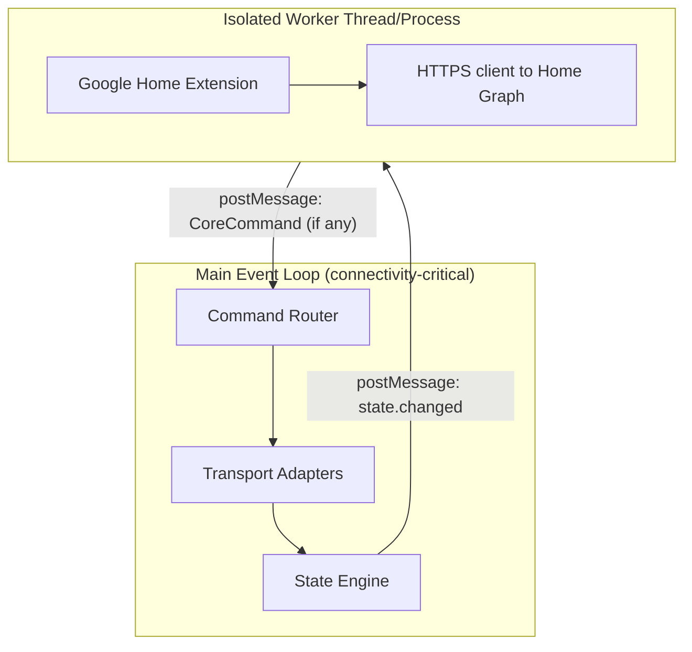

# 10. Concurrency & Zero-Lag Strategy

[← 9. Event-Driven Data Flow](./09-event-driven-data-flow.md) | [Back to index](./README.md) | Next: [11. Glossary & ADRs →](./11-glossary-and-adrs.md)

---

## 10.1 The Core Risk

Node.js is single-threaded for JavaScript execution. The same event loop that processes an incoming MQTT telemetry message from a hardware client also, by default, would process an extension's `onStateChanged` callback. If that callback does anything synchronously slow — a blocking crypto operation, a large JSON transform, or (worst case) a network call awaited in a way that stalls the loop — every other connected device's telemetry and commands queue up behind it. At scale, this is the single biggest threat to the "real-time" promise of the Connectivity Broker ([Ch. 5](./05-connectivity-broker.md)).

The architecture treats this as a first-class constraint (Principle P4, [Ch. 1, §1.2](./01-overview.md#12-design-principles)), enforced at multiple layers rather than left to extension author discipline alone.

## 10.2 Layer 1 — Async-Only Extension Contract

Every hook in `CoreExtension` ([Ch. 7, §7.4](./07-extension-engine.md#74-the-coreextension-interface)) returns a `Promise`. The engine invokes hooks and does not await their completion before continuing to process the next event on the bus — the emission of `state.changed` is fire-and-forget from the engine's perspective with respect to *extension* processing:

```ts
// Extension Engine — simplified dispatch loop
bus.on("state.changed", (event) => {
  for (const ext of enabledExtensions) {
    if (ext.onStateChanged) {
      // Not awaited here — engine does not block on extension work.
      Promise.resolve(ext.onStateChanged(event, ext.context)).catch(err =>
        logger.error(`Extension ${ext.manifest.id} onStateChanged failed`, err)
      );
    }
  }
});
```

This guarantees that a slow or failing extension cannot delay delivery of `state.changed` to *other* extensions, nor delay the engine's next iteration of processing incoming broker events.

## 10.3 Layer 2 — Per-Hook Timeouts & Circuit Breaking

Fire-and-forget alone doesn't stop a misbehaving extension from monopolizing the event loop with synchronous work (a `Promise` executor can still run blocking code before its first `await`). The engine wraps every hook invocation with:
- A **soft timeout** (configurable, default 500ms) — if a hook hasn't resolved within the window, it's logged as slow; repeated violations flag the extension for review in the admin dashboard.
- A **circuit breaker** — an extension whose hooks throw or time out above a threshold (default: 5 consecutive failures) is automatically transitioned to `disabled` ([Ch. 7, §7.2](./07-extension-engine.md#72-extension-lifecycle)) until an operator re-enables it, preventing a degrading extension from cumulatively worsening system health.

## 10.4 Backpressure & Rate Limiting

- **Per-client rate limits** at the Transport Adapter layer ([Ch. 5, §5.6](./05-connectivity-broker.md#56-backpressure--delivery-guarantees)) prevent a single device from flooding the normalizer/state-engine pipeline.
- **Bounded extension queues**: if process-isolated extensions (§10.5) fall behind, their inbound event queue is capped; once full, new events are dropped for that extension specifically (logged as `extension.backpressure_drop`) rather than applying backpressure to the entire Core — one slow extension degrades gracefully rather than propagating stalls upstream.

## 10.5 Layer 3 — Process Isolation for Heavy Extensions

For extensions whose normal operation involves non-trivial work per event — exactly the Google Home extension's profile, which makes an outbound HTTPS call to Home Graph on every relevant `state.changed` ([Ch. 8, §8.4](./08-google-home-extension.md#84-realtime-state-reporting--home-graph)) — the manifest's `runtime: "worker"` option ([Ch. 7, §7.7](./07-extension-engine.md#77-process-isolation-mode)) moves hook execution off the main thread entirely:



Communication crosses the thread/process boundary via structured-clone message passing (or an internal RPC layer for full child processes), so even if the Google Home extension's HTTPS call to Home Graph hangs for seconds, the main thread — handling live MQTT/WebSocket traffic for every connected device — is entirely unaffected.

## 10.6 Why Fire-and-Forget Is Safe Here (and Where It Isn't)

Fire-and-forget HTTP calls to Home Graph are acceptable because:
1. `reportStateAndNotification` is idempotent from the Core's perspective — a dropped or delayed report is a stale Google Home UI, not a corrupted system state (the Core's own `StateEntry` remains correct regardless of Home Graph delivery success).
2. Failures are logged and retried with backoff **inside the extension**, not surfaced as Core errors.

Fire-and-forget is **not** used for the command dispatch path (`ctx.commands.dispatch`) — a command intended to physically actuate a device is awaited and acknowledged (optionally via `correlationId`, [Ch. 5, §5.4](./05-connectivity-broker.md#54-routing-inbound-telemetry-and-outbound-commands)), because losing a command silently would be a functional regression, not just a stale read.

## 10.7 Summary Table

| Mechanism | Protects against | Chapter |
|---|---|---|
| Async-only hook contract | Engine blocking on extension code | §10.2 |
| Per-hook timeout + circuit breaker | Slow/failing extension degrading system health over time | §10.3 |
| Per-client rate limiting | A single device flooding the pipeline | §10.4, [Ch. 5, §5.6](./05-connectivity-broker.md#56-backpressure--delivery-guarantees) |
| Bounded extension queues | One slow extension backing up the whole bus | §10.4 |
| Worker-thread/process isolation | Heavy extension work (webhooks, external API calls) touching the main loop at all | §10.5 |
| Fire-and-forget for non-critical externals, awaited for commands | Choosing the right reliability/latency tradeoff per call type | §10.6 |

---

[← 9. Event-Driven Data Flow](./09-event-driven-data-flow.md) | [Back to index](./README.md) | Next: [11. Glossary & ADRs →](./11-glossary-and-adrs.md)
